# MedalUI

> **A bespoke, artful HUD, unit frame and console suite for World of Warcraft.**

MedalUI turns the game's interface into one ornamental console in an ink-and-gold style. It wraps Blizzard's secure templates instead of replacing them, so combat security, macros, drag-and-drop and key bindings all work as they do in the default UI.

Runs on **WoW Forever** (`16001`) and **Retail** (`120105`).

**Get it:** [CurseForge](https://www.curseforge.com/wow/addons/medalui) · [GitHub](https://github.com/ahrymx/ahrymx.MedalUI)

> [!IMPORTANT]
> **Formerly Medalluin.** MedalUI is the same addon under a new name. Remove the old `Medalluin` folder from `Interface/AddOns` before installing it. The new name starts with fresh settings. To keep yours, close the game, then in `WTF/Account/<account>/SavedVariables` rename `Medalluin.lua` to `MedalUI.lua` and change `MedalluinDB` to `MedalUIDB` inside it. Do the same in each character's `WTF/Account/<account>/<realm>/<character>/SavedVariables` folder, changing `MedalluinCharDB` to `MedalUICharDB`.

> [!NOTE]
> **MedalUI is developed with the assistance of AI.** Design, art tooling and code are co-authored with AI under human direction and in-game testing, then linted and harness-tested for taint and combat safety.

---

## The console

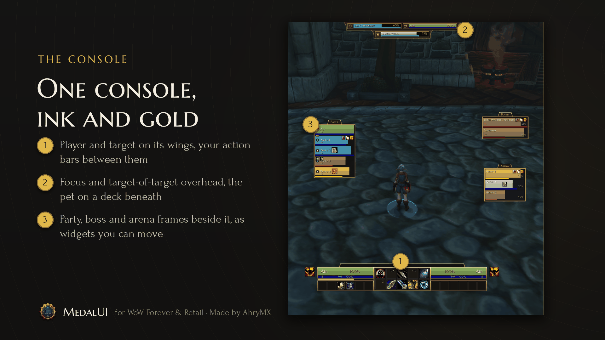

- **Two profiles:** the slim **Reticule** (default), with the minimap in the console's bay, or the round **Arena**. *Arena is a work in progress: expect rough edges.*
- **Action bars:** one to three rows, with Blizzard's button art or bare icons. Empty buttons hide and come back while you drag a spell, item or macro.
- **Class power and cast bars** are built into the console: combo points, holy power, runes, soul shards and the rest.
- **Party, raid, boss and arena** frames sit on the console's own row or in widgets you can drag. **Minimal OoC Mode** fades the console out of combat.

## Themes

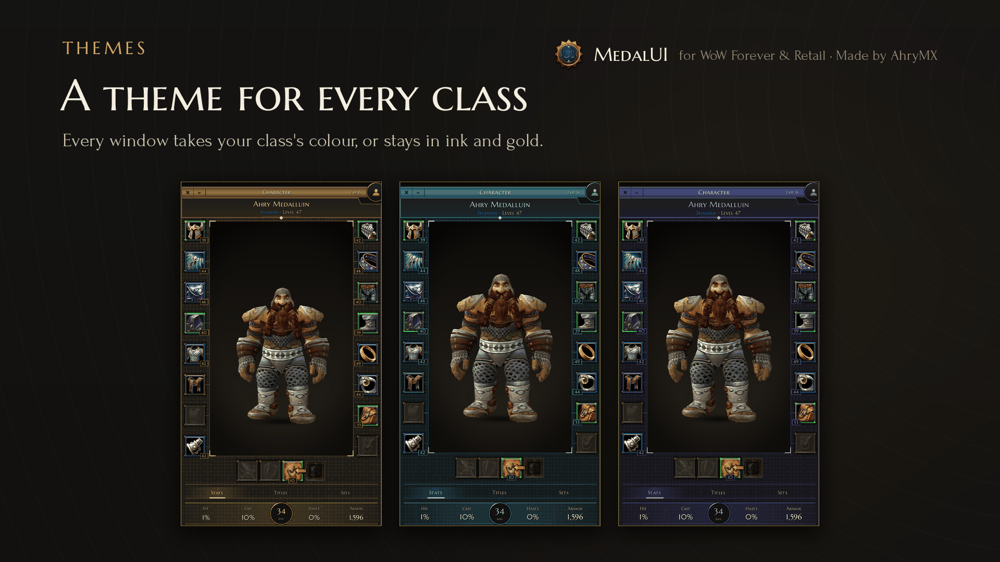

- Every window can take your class's colour, or stay in ink and gold.

## Spellbook and macros

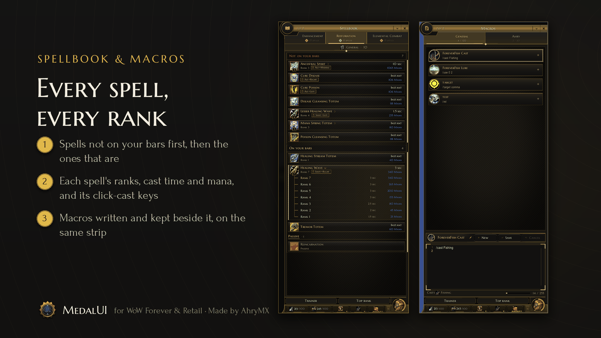

- Spells not on your bars come first, then the ones that are, each with its click-cast keys.
- Unfold a spell to see its ranks, with cast time and mana.

## Quests

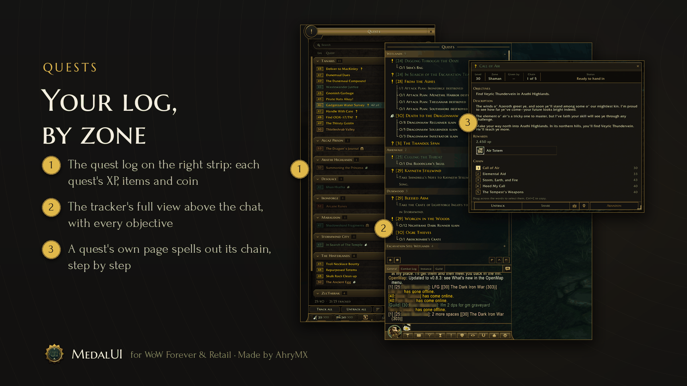

- **The quest log** on the right strip, by zone, with each quest's XP, item and coin rewards.
- **The tracker's full view** above the chat, with every objective.
- **A quest's own page** lays out its chain step by step. The whole chain needs [QuestieDB](https://www.curseforge.com/wow/addons/questiedb).
- On WoW Forever, MedalUI turns on the game's hidden in-world marker at each login (**Marker in the world**, under Quests > Behaviour). The game's update of 21 November broke the marker, so the option stays greyed out until the game fixes it.

## Side panel

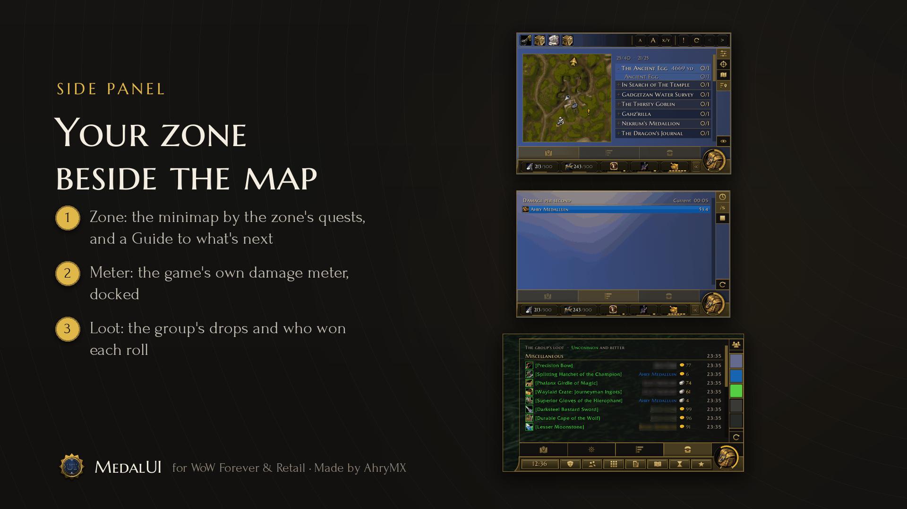

- **Zone:** the minimap beside the zone's quests. Click a quest for its objectives, or shift-click it to track it. Its sort button holds a **Guide** to what to do next for experience, and the waypoint follows the top of that list. The Guide needs [QuestieDB](https://www.curseforge.com/wow/addons/questiedb).
- **Zone controls:** a bar of the quests' usable items, which work in combat, plus text size and coordinates.
- **Meter** docks the game's own damage meter. **Auras** lists your buffs and debuffs. **Loot** shows the group's drops and who won each roll.
- Addons' minimap buttons gather in a drawer at the end of the action bar.

## Chat and the corner strips

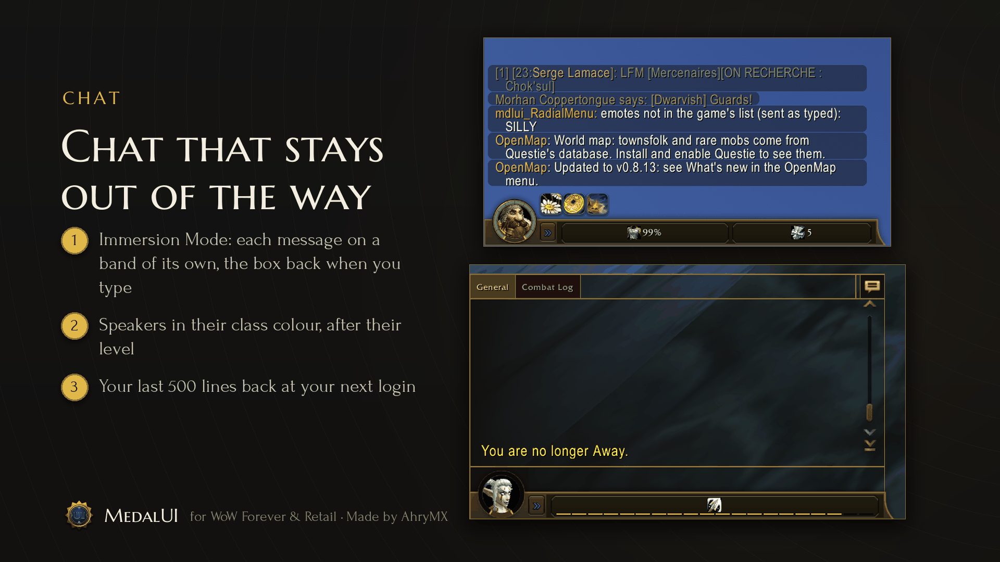

- **Immersion Mode** (Shared > Visibility & fading) gives each message a band of its own and brings the box back while you type or point at it.
- Speakers are named in their class colour, after their level. Each window's last 500 lines come back at your next login, and the **Log** button opens a copyable log.
- **The corner strips** are drawers. Closed, they show durability, ammo, reagents and professions. The chevron unrolls the menu buttons.

## NPC windows

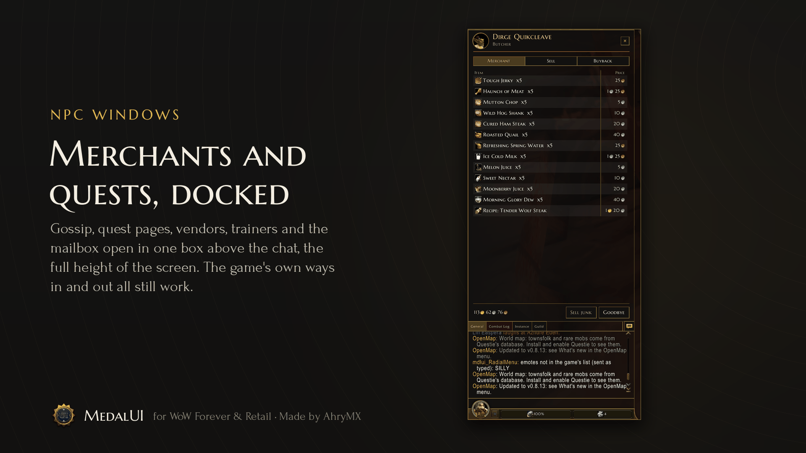

- Gossip, quest pages, vendors, trainers and the mailbox all open in one box above the chat, the full height of the screen.

## Loot rolls

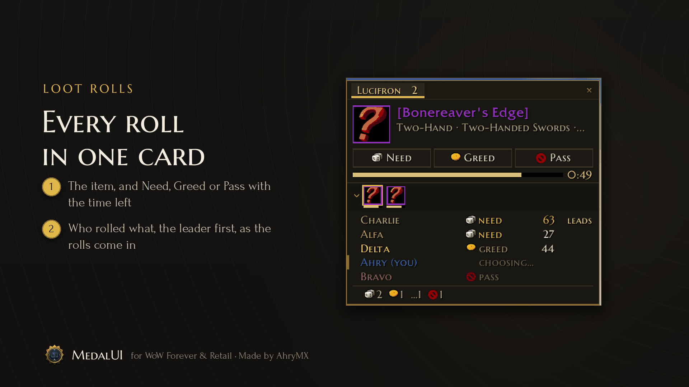

- One card per roll: the item, then Need, Greed or Pass with the time left.
- Everyone's rolls fill in as they come, with the leader marked and a tally at the foot.

## Character and bags

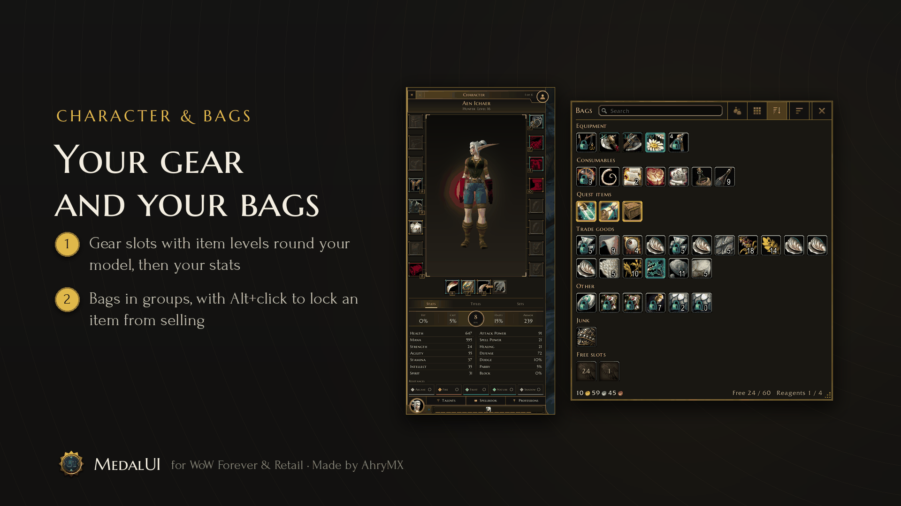

- **Bags** (inspired by Baganator) put the backpack, bags and reagent bag in one window, grouped as New, Equipment, Consumables, Quest items, Trade goods and Junk.
- **Alt+click** an item to lock it: it shows a padlock and can't be sold or destroyed.

## Talents and plans

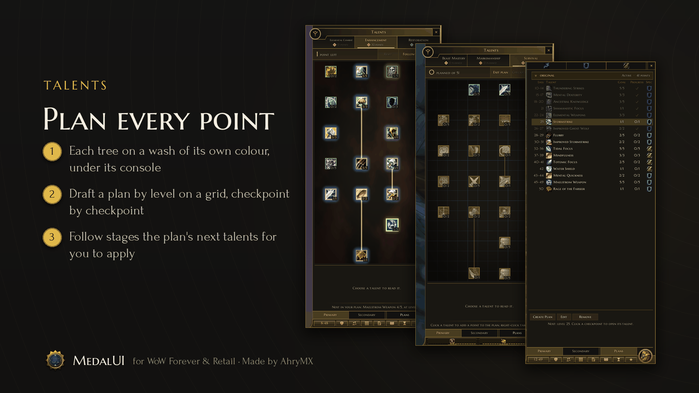

- Each tree sits under a console showing its points, the points left and the next step of your plan, with **Reset**, **Follow** and **Apply** buttons.
- **Plans:** draft a build by level on a grid, add a **Checkpoint** at each step, then **Save plan**. **Follow** stages the plan's next talents for you to apply.

## Professions

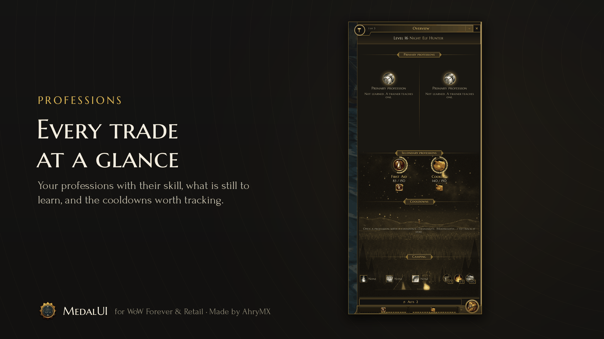

- Your professions with their skill, what you can still learn, and the cooldowns worth tracking.

## Game menu

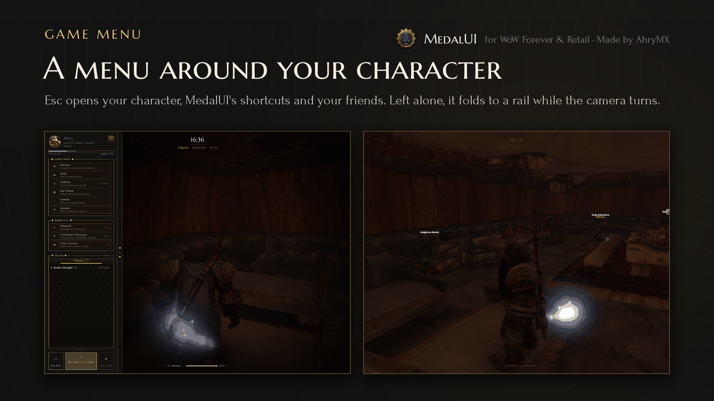

- Esc opens your character, MedalUI's shortcuts, and your friends and guild in a Social window.
- A clock at the top shows your gold, session length and latency. Your volumes sit at the bottom.
- Left alone, the menu folds to a rail while the camera turns. The cog sets how the world is dimmed.

## Click casting

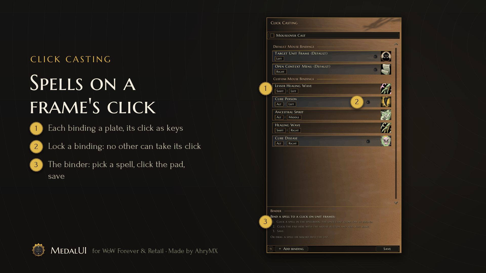

- Each binding is a plate showing its click as keys.
- **Lock** a binding with its padlock, so no other binding can take its click. Locked bindings are tinted blue.
- To bind a spell, pick it in the spellbook, click the pad, then save. You can also drag a spell or macro into the list.

## Cooldown Manager

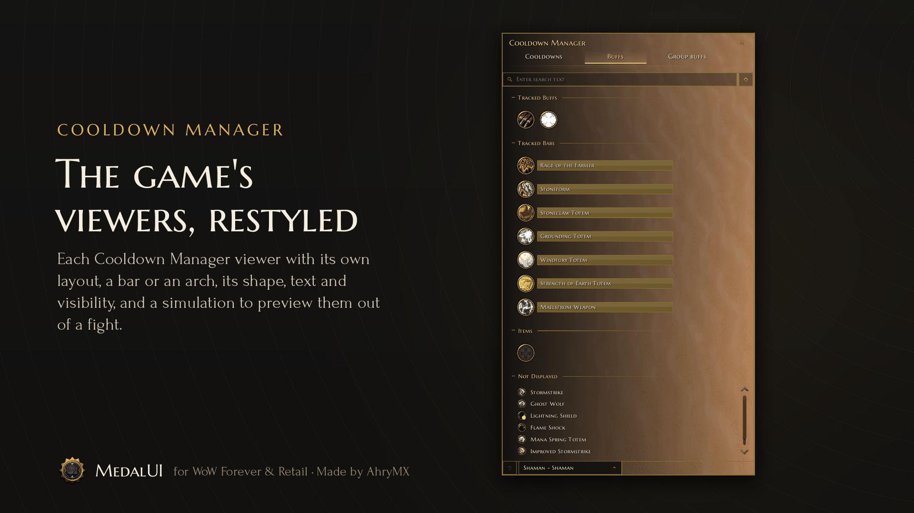

- Each of the game's Cooldown Manager viewers gets its own layout (a bar or an arch), shape, text and visibility.
- A simulation previews them out of combat. Movers place them in Edit Mode.

## Tooltips

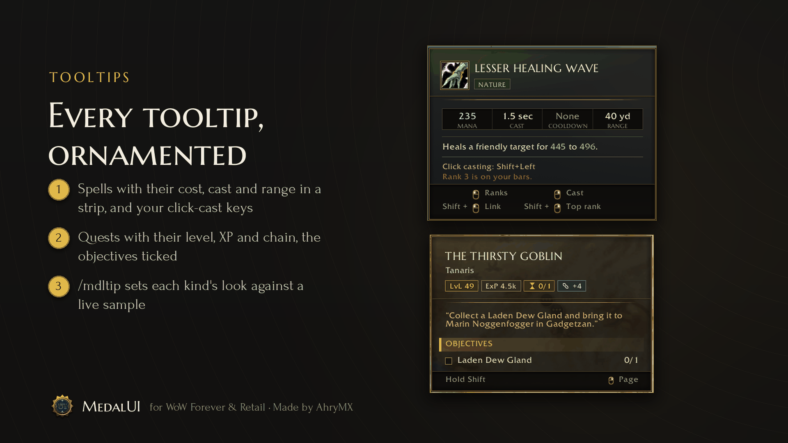

- Every tooltip is an ornamented panel: items, spells, units, auras, quests, mail and world objects.
- `/mdltip` sets each kind's look against a live sample. To keep the game's tooltips, untick **Tooltips > Reskin tooltips**.
- Based on [PrettyTooltip](https://github.com/FallenShard/PrettyTooltip) by FallenShard ([README](https://github.com/ahrymx/ahrymx.MedalUI/blob/main/WoW/Interface/AddOns/MedalUI/tooltips/README.md) · [MIT](https://github.com/ahrymx/ahrymx.MedalUI/blob/main/WoW/Interface/AddOns/MedalUI/tooltips/LICENSE)).

> [!NOTE]
> Tooltips used to be the `mdlui_Tooltips` companion addon. If its folder is still installed, MedalUI turns it off and asks for a `/reload`. Your tooltip settings carry over, and you can then delete the folder.

## Settings

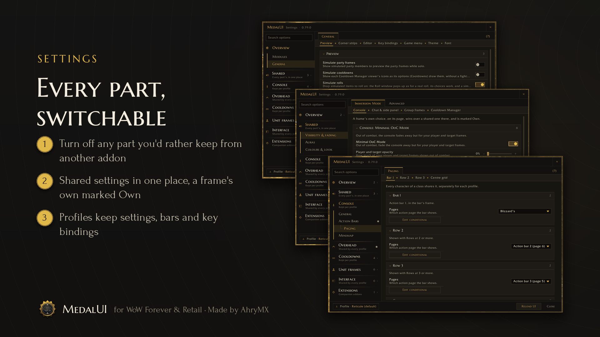

- Switch off any part of MedalUI on the **Modules** page, to keep another addon's or the default UI's.
- **Shared** settings cover every part at once. A frame's own setting wins over the shared one and is marked **Own**.
- **Profiles** keep your settings, action bar skills and key bindings.
- **Unit frame editor** (`/mui edit`) and **key binding mode** (`/mui kb`).

## Radial menu (companion)

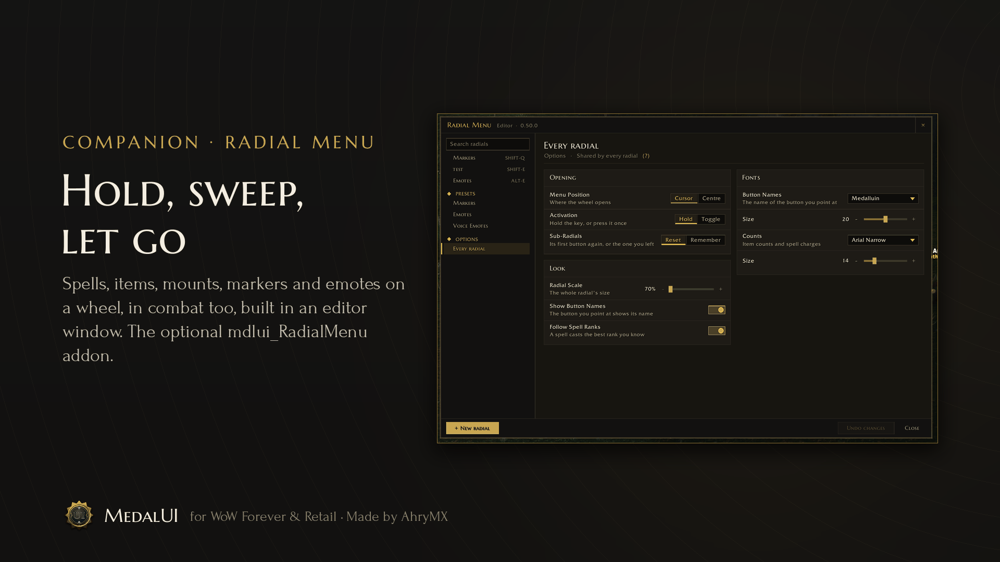

- Hold a key, sweep the mouse towards a button and let go, in combat too. The radials are built in an editor window.
- It comes with the optional `mdlui_RadialMenu` addon (below).

---

## Companion addons

Companions appear under the **MedalUI** category in the AddOn List, each with its own documentation and license.

| Addon | What it adds | Docs & license |
|:---|:---|:---|
| **[`mdlui_RadialMenu`](https://github.com/ahrymx/ahrymx.MedalUI/blob/main/WoW/Interface/AddOns/mdlui_RadialMenu/README.md)** | Radial menus: hold a key, sweep the mouse towards a button and let go, in combat too. Spells, items, mounts, macros, markers, emotes and nested radials, built in an editor window, with presets such as Consumables, a shaman's Totem Bars and a hunter's Pet Utility. Forever. Based on [FlareUI](https://github.com/malkkav/FlareUI)'s radial menu by Malkkav. | [README](https://github.com/ahrymx/ahrymx.MedalUI/blob/main/WoW/Interface/AddOns/mdlui_RadialMenu/README.md) · [MIT](https://github.com/ahrymx/ahrymx.MedalUI/blob/main/WoW/Interface/AddOns/mdlui_RadialMenu/LICENSE) |

## Recommended addons

> [!TIP]
> **Install [QuestieDB](https://www.curseforge.com/wow/addons/questiedb). It is strongly recommended.** QuestieDB is the quest, creature, object and item database behind Questie, released as an addon of its own. MedalUI reads it while the game runs and copies none of it. On WoW Forever the game itself can't say much about a quest beyond what is in your log, so QuestieDB fills the gaps:
>
> - **The Zone tab's Guide**, which plans what to do next for experience, only works with it.
> - **Quest chains:** a quest's page lays out the whole chain with each step's name, level and experience, where the game can't.
> - **Drop rates:** the tracker and quest pages show how often a quest item drops ("Gnoll Paw: 3/8 · 12-18% drop"), with each creature's rate in the objective's tooltip.
> - **Quest items:** the Zone tab's item bar also offers the items a quest needs that the game doesn't mark, once they are in your bags.
> - **Quest tooltips:** hold Shift over a quest, on the world map too, to see who starts and ends it and where, its place in the chain, and the reputation it gives.
>
> Questie itself isn't needed: QuestieDB works on its own. Without it, these features are hidden and everything else works as usual.
>
> **Running Questie alongside it isn't recommended.** MedalUI already has Questie's features, improved, so Questie only doubles them. Its map pins also hide the game's objective markers, which waypoints to quests need. When both are loaded, MedalUI offers once to turn Questie off and leave QuestieDB on.

These addons are by other authors and pair well with MedalUI. They are not part of it: install each one separately from CurseForge.

| Addon | What it adds | Clients |
|:---|:---|:---|
| **[PlateSCT](https://www.curseforge.com/wow/addons/platesct)** | Scrolling damage and healing numbers above enemy nameplates or in movable screen areas. | Forever · Retail |
| **[Shadowflare](https://www.curseforge.com/wow/addons/shadowflare)** | On-screen alerts for spell procs: when your next spell is instant, faster, free or usable. | Forever |
| **[MF Nameplates](https://www.curseforge.com/wow/addons/mf-nameplates)** | Customizable nameplates with a live visual designer. | Forever · Retail |
| **[LootOptimizer Forever](https://www.curseforge.com/wow/addons/lootoptimizer-forever)** | Frees bag space for new loot when your bags are full, and compares gear upgrades for you and your alts. | Forever |
| **[Keep or Toss: Forever](https://www.curseforge.com/wow/addons/keep-or-toss-forever)** | A tooltip section saying whether an item is useful to your character, and why. | Forever |

---

## Slash commands

| Command | What it does |
|:---|:---|
| `/mui`, `/mdlui` or `/medalui` | Opens the settings window |
| `/mui bar` | Opens settings at the action bars |
| `/mui party` · `raid` · `boss` | Opens settings at that unit frame page |
| `/mui kb` | Key binding mode: hover a button and press a key |
| `/mui edit` | Opens the unit frame editor |
| `/mui taint` | Runs taint diagnostics |
| `/mdltip` | Opens the tooltips' window: each kind's look, with a live sample |
| `/mui fix-issues` | Checks for problems an older version left behind that updating does not undo, and offers to fix them |

---

## Credits and inspiration

- **[W2UI](https://wowinterface.com/downloads/info27203-W2UI.html)** by aesketch: a design reference for the character window, the corner medallions and the utility bars. Used as a reference only; no code or art is taken from it.
- **[Baganator](https://www.curseforge.com/wow/addons/baganator)**: inspiration for the bags window.
- **[Forever Quest Routes](https://www.curseforge.com/wow/addons/forever-quest-routes)** by j__b: the model for the Zone tab's Guide. Used as a reference only; no code or data is taken from it. The Guide reads QuestieDB while the game runs.
- **[PrettyTooltip](https://github.com/FallenShard/PrettyTooltip)** by FallenShard: the base of MedalUI's tooltips (MIT).
- **[FlareUI](https://github.com/malkkav/FlareUI)** by Malkkav: its radial menu is the base of `mdlui_RadialMenu` (MIT).
- **Marcellus SC** by Brian J. Bonislawsky (Astigmatic): the interface font (SIL OFL 1.1).

## Work in progress and contributions

> [!IMPORTANT]
> **MedalUI is a work in progress.** Features, textures and options keep changing.

- **Issues:** bug reports, compatibility problems and suggestions are welcome on GitHub.
- **Pull requests:** welcome. Please make sure your change passes `luacheck` and the test harness first. By opening one, you agree to the contribution terms in section 4 of the [LICENSE](https://github.com/ahrymx/ahrymx.MedalUI/blob/main/LICENSE).

---

## License

MedalUI is **All Rights Reserved** © 2026 AhryMX. You may install it, play with it, read its code, and change your own copy for personal use. Screenshots, videos, and streams are welcome. You may not reupload, redistribute, fork, retexture, or rebrand it, in whole or in part, without written permission. The only official copies are on [GitHub](https://github.com/ahrymx/ahrymx.MedalUI) and [CurseForge](https://www.curseforge.com/wow/addons/medalui/). See [LICENSE](https://github.com/ahrymx/ahrymx.MedalUI/blob/main/LICENSE) for the full terms.

MedalUI's tooltips (`MedalUI/tooltips`) are based on [PrettyTooltip](https://github.com/FallenShard/PrettyTooltip) © 2026 FallenShard and are included under the [MIT License](https://github.com/ahrymx/ahrymx.MedalUI/blob/main/WoW/Interface/AddOns/MedalUI/tooltips/LICENSE). The optional `mdlui_RadialMenu` companion addon is based on the radial menu of [FlareUI](https://github.com/malkkav/FlareUI) © 2026 Malkkav and is included under the [MIT License](https://github.com/ahrymx/ahrymx.MedalUI/blob/main/WoW/Interface/AddOns/mdlui_RadialMenu/LICENSE). The Marcellus SC font is © Brian J. Bonislawsky (Astigmatic) and is included under the [SIL Open Font License 1.1](https://github.com/ahrymx/ahrymx.MedalUI/blob/main/WoW/Interface/AddOns/MedalUI/media/fonts/OFL.txt). World of Warcraft is a trademark of Blizzard Entertainment, Inc.; MedalUI is not affiliated with or endorsed by Blizzard.
