# MedalUI

> **A bespoke, artful HUD, unit frame and console suite for World of Warcraft.**

MedalUI turns the game's interface into one ornamental console in an ink-and-gold style. It wraps Blizzard's secure templates instead of replacing them, so combat security, macros, drag-and-drop and key bindings all work as they do in the default UI.

Runs on **WoW Forever** (`16001`) and **Retail** (`120105`).

**Get it:** [CurseForge](https://www.curseforge.com/wow/addons/medalui) · [GitHub](https://github.com/ahrymx/ahrymx.MedalUI)

> [!IMPORTANT]
> **Formerly Medalluin.** MedalUI is the same addon under a new name. Remove the old `Medalluin` folder from `Interface/AddOns` before installing it. The new name starts with fresh settings. To keep yours, close the game, then in `WTF/Account/<account>/SavedVariables` rename `Medalluin.lua` to `MedalUI.lua` and change `MedalluinDB` to `MedalUIDB` inside it. Do the same in each character's `WTF/Account/<account>/<realm>/<character>/SavedVariables` folder, changing `MedalluinCharDB` to `MedalUICharDB`.

> [!NOTE]
> **MedalUI is developed with the assistance of AI.** Design, art tooling and code are co-authored with AI under human direction and in-game testing, then linted and harness-tested for taint and combat safety.

---

## The console

The console sits at the bottom: player and target on its wings, action bars in between. The overhead at the top holds your focus and target-of-target side by side, with your pet on a narrower deck beneath; with neither shown, the pet rises to the top.

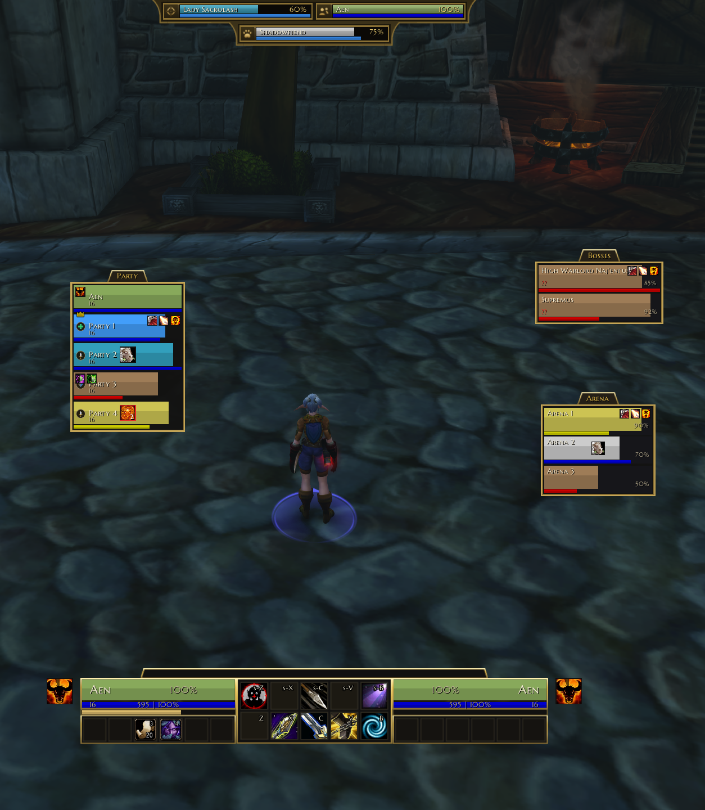

- **Two profiles:** the slim **Reticule** (default), or the round **Arena** below.
- **Reticule:** the minimap sits in the console's bay, with a 2×5 form, stance and skyriding grid (Action Bar 7) and a party row under the console. Its Minimal OoC Mode fades the console away out of combat, leaving your player and target frames faint until combat brings it back; it can stay half-seen while your health or mana refills.
- **Action bars:** one to three rows, with Blizzard's button art or **bare icons**. Empty buttons hide and reappear while you drag a spell, item or macro.
- **Class power and cast bars** built into the console: combo points, holy power, runes, soul shards and the rest.
- **Party, raid and arena** frames: on the console's own row, or as draggable widgets. Bosses get their own movable widget. Offline and dead members get a look of their own: a plug icon, or wings and a timer.

### Arena

The medallion console: the party on wings around a large player and target, with the minimap in its ring.

> **Work in progress:** Arena is still being built, so expect rough edges. Its showcase will return when it's ready.

---

## The corner strips

The bottom corners carry a strip each, beside a medallion: your portrait on the left, under the chat box, and the backpack on the right. Each strip is a drawer: closed, it shows your durability (a hunter's ammo, as a gauge), your class reagents and your professions (secondary ones as pip gauges); the chevron by the medallion unrolls the menu buttons over it. The queue eye takes the portrait's place while you are queued, and a vehicle exit takes the backpack's on the right. Immersion Mode (Shared > Visibility & fading) leaves the idle chat bare, each message on a band of its own, with its box back while you type or point at it; it fades the side panel when idle too.

The chat box names a speaker in their class colour, after their level in its difficulty colour against yours. A link's tooltip stands to the right of the box, hovered or clicked, as every docked window's does. Each window's last 500 lines come back at your next login, dimmed under a divider (Chat > History: Off to 1000, per character). The Log button in the chat's drawer opens a copyable log, with a tab for each chat window.

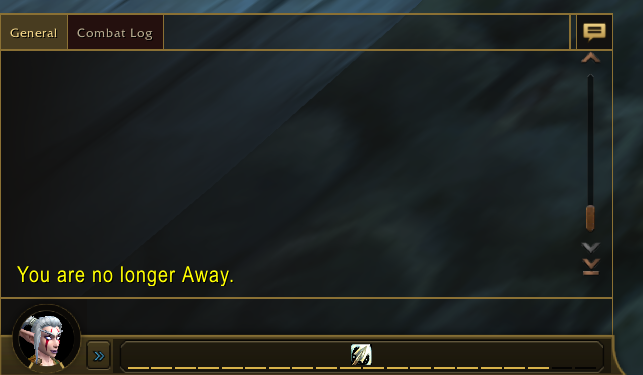

### Side panel

The right strip opens a panel with tabs. **Zone** lends it the minimap beside the current zone's quests; **Loot** lists the group's drops and who won each roll.

| Zone | Loot |
|:---:|:---:|
| 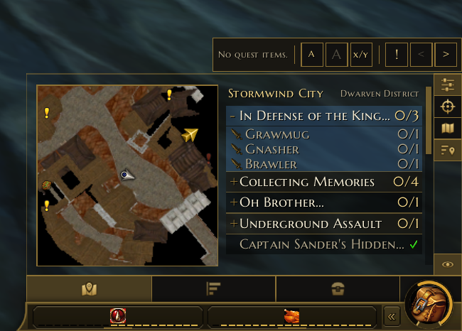 |  |

- **Meter** shows the game's own damage meter, on clients that have one; **Auras** lists your buffs and debuffs, live in combat.
- In the Zone tab, click a quest for its objectives, or shift-click it to track it.
- The Zone tab's sort button also has a **Guide**: what to do next for experience. Quests to take near you and quick objectives come first, whichever is nearer (quests to take equally near by their experience and their chain's). Then come hand-ins, then objectives spread over a wide area, nearest first. A hand-in within 300 yards goes before everything, or within 700 when its chain has another quest after it. The waypoint follows the top of the list; Ctrl+right-click a quest to take to ignore it, so the waypoint passes it by (it stays in the list, striped). It needs [QuestieDB](https://www.curseforge.com/wow/addons/questiedb).
- The Zone tab's top button opens its **controls** over the panel: a bar of the listed quests' usable items (with QuestieDB, also the ones a quest needs that the game does not mark, such as a necklace to open, once they are in your bags), the list's text size, coordinates on or off, and, with the Guide shown, quests to take on or off and the waypoint moved a row down or up its list (the rows stay put). The mouse wheel on the minimap zooms.
- The Zone tab's quest items and its controls' item bar work in combat. While one is out, its rows stand still until the fight ends: a quest finished, a fold or a scroll waits, and counts change in place. An item that turns up in combat shows the bags' padlock until it can be used.
- Addons' minimap buttons gather in a **drawer** at the end of the action bar, instead of crowding the minimap.

---

## Quests

| Quest tracker & chat | Quest log |
|:---:|:---:|
|  |  |

A quest's own page spells out where it sits in its chain, step by step, with its giver, objectives and rewards.

On WoW Forever, MedalUI turns on the game's hidden in-world marker (`showInGameNavigation`) at each login. The marker is a diamond with its distance, shown at your tracked quest's objective or at your waypoint. To leave it off, untick **Marker in the world** under Quests > Behaviour. WoW Forever's update of 21 November broke the marker, even when typed by hand, so the option stays greyed with a note until the game has it again.

---

## Character, bags and spells

| Character | Bags |
|:---:|:---:|
| 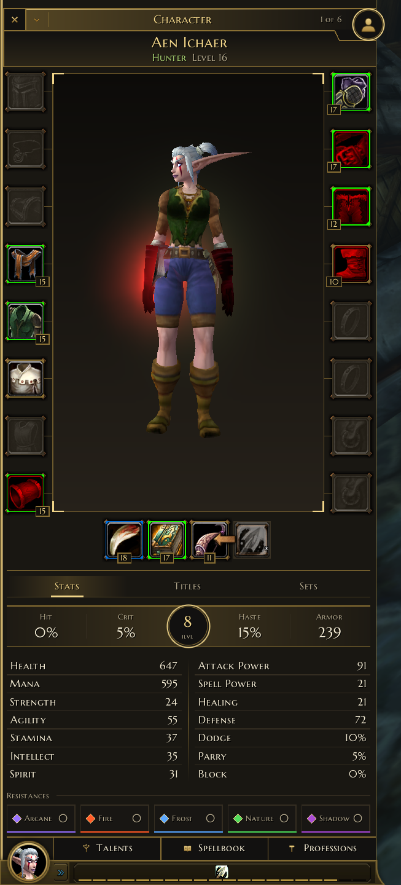 |  |

| Spellbook | Macros |
|:---:|:---:|
| 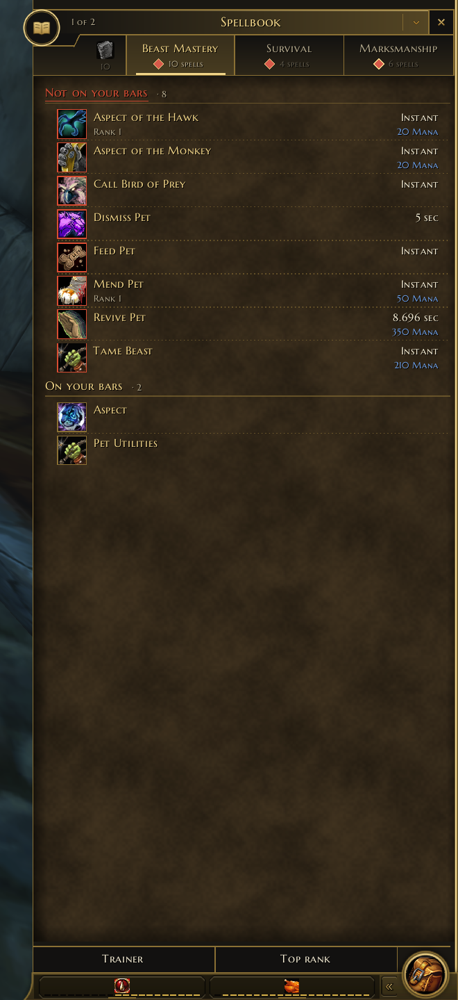 |  |

| Professions |
|:---:|
| 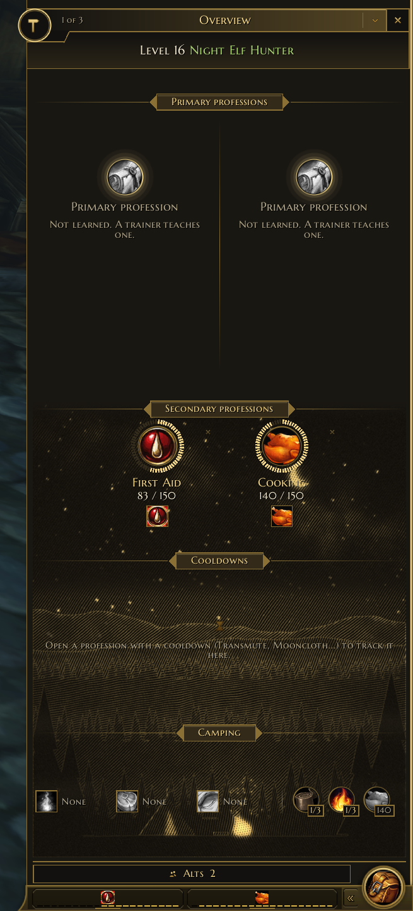 |

- **Bags** (inspired by Baganator) put the backpack, bags and reagent bag in one window. Items are grouped (New, Equipment, Consumables, Quest items, Trade goods, Junk), and the equipped bags open in a drawer above.
- **Alt+click** an item to lock it: it shows a padlock and can't be sold or destroyed.

### Talents and plans

Each tree sits on a faint wash of its own colour, under a console showing its points, the points left and the next step in your plan, with **Reset**, **Follow** and **Apply** beneath. Talents with points chosen but not yet applied pulse softly (green, or blue when full), learned ones keep a still aura, and maxed ones shine. The game's own talent sounds play as you spend, take back and apply points. Choosing a talent reads out what each rank gives, the current one in green.

A **plan** lays out a build by level. In plan mode the tree turns to a drafting grid: click to add points, **Checkpoint** each step, then **Save plan**. Each talent shows its levels, goal and progress, the next checkpoint is lit, and **Follow** stages the plan's next talents for you to apply.

| Talents | A talent's ranks |
|:---:|:---:|
| 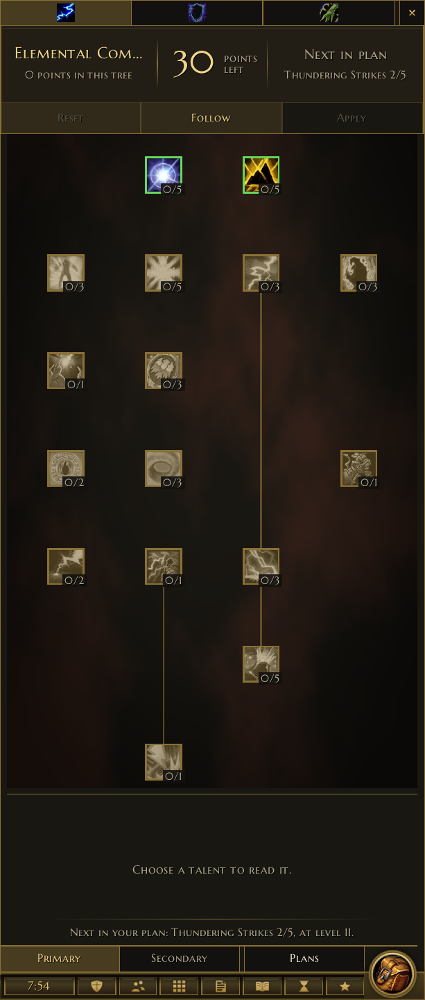 | 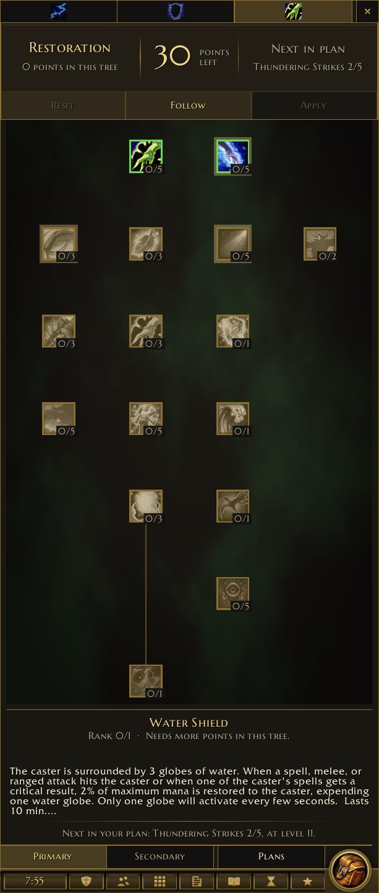 |

| Drafting a plan | Talent plans |
|:---:|:---:|
| 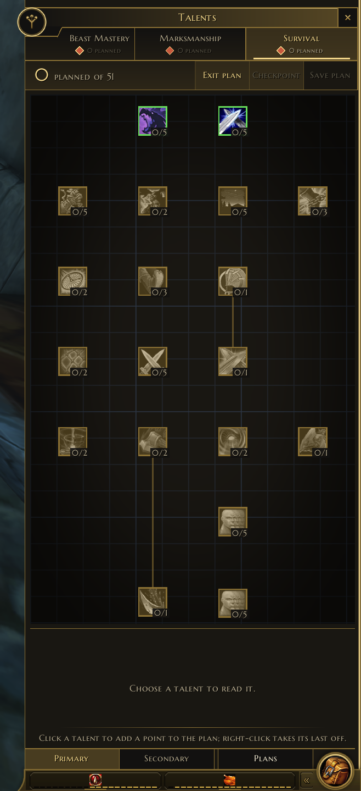 |  |

---

## Game menu

Esc opens a game menu that also shows your character, MedalUI's shortcuts, and your friends and guild on two tabs of a Social window. A clock at the top of the screen shows the time, with your gold, session length and latency under it. Your volumes sit at the bottom of the screen: Master, with Music, Effects, Ambience and Dialogue in a tray above it and a shortcut to the game's Audio settings. Left alone, the panel folds into a thin rail at the edge while the camera turns slowly around your character. The cog opens the menu's options, among them how the world behind the menu is dimmed: a vignette or an even shade, its strength and its tint.

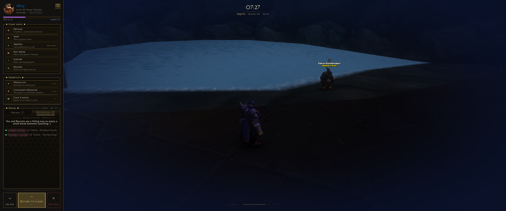

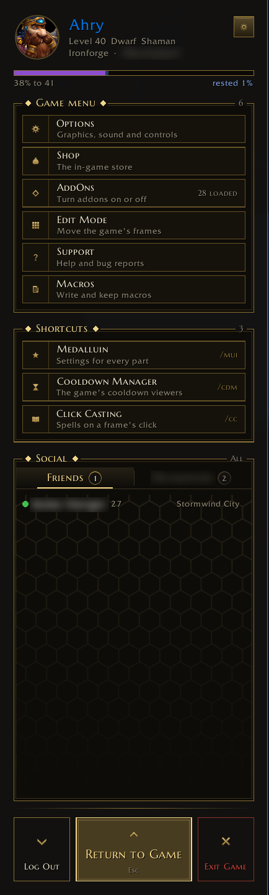

---

## Settings

Every part of MedalUI can be switched off on the **Modules** page; turn off what you'd rather keep from another addon or the default UI.

| | |
|:---:|:---:|
| 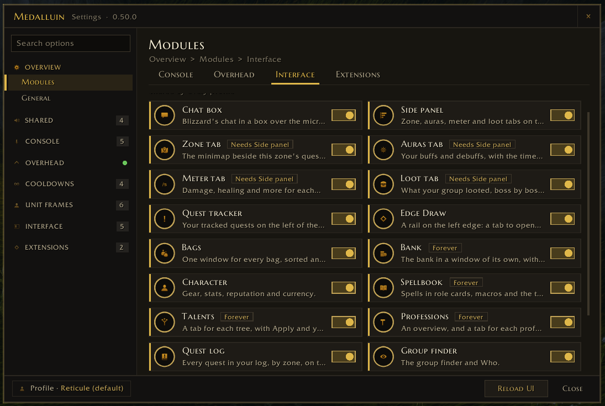 | 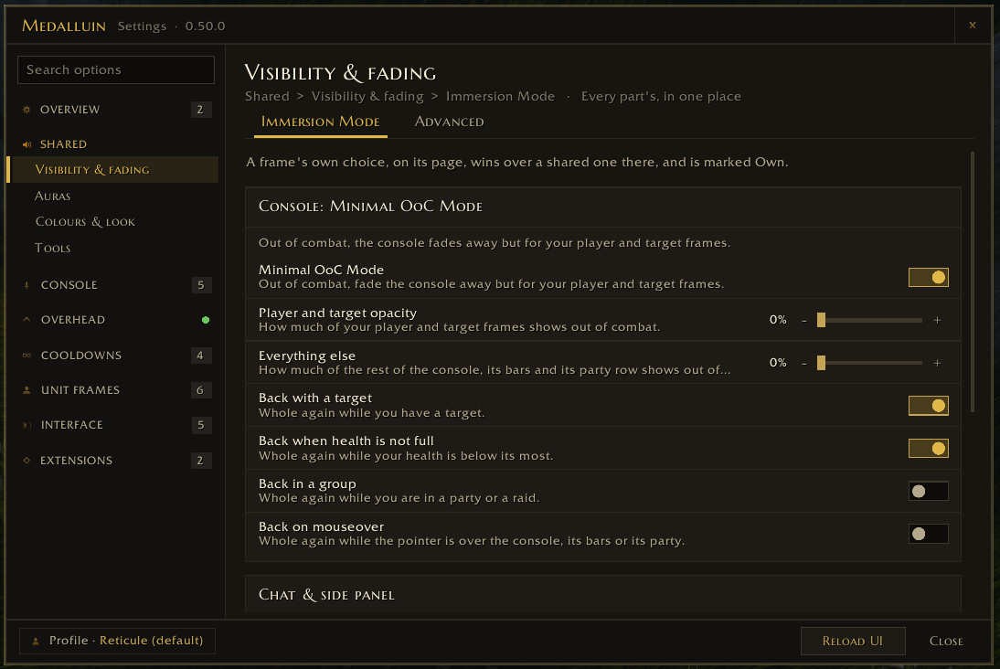 |

- **Profiles:** settings, action bar skills and key bindings are kept per profile and restored when you switch.
- **Unit frame editor** (`/mui edit`): every piece's size, font, text and place, on a live canvas.
- **Movers** in Edit Mode for the consoles, widgets and cooldown viewers.
- **Cooldowns:** the game's Cooldown Manager viewers, each with its own layout (a bar or an arch), shape, text and visibility, and its tracked bars in the same ink and gold, plus a simulation to preview them.
- **Key binding mode** (`/mui kb`): hover a button and press a key.

---

## Companion addons

Companions appear under the **MedalUI** category in the AddOn List, each with its own documentation and license.

| Addon | What it adds | Docs & license |
|:---|:---|:---|
| **[`mdlui_Tooltips`](https://github.com/ahrymx/ahrymx.MedalUI/blob/main/WoW/Interface/AddOns/mdlui_Tooltips/README.md)** | An ornamented reskin of every tooltip: items, spells, units, auras, quests, mail and world objects. Forever and Retail. Based on [PrettyTooltip](https://github.com/FallenShard/PrettyTooltip) by FallenShard. | [README](https://github.com/ahrymx/ahrymx.MedalUI/blob/main/WoW/Interface/AddOns/mdlui_Tooltips/README.md) · [MIT](https://github.com/ahrymx/ahrymx.MedalUI/blob/main/WoW/Interface/AddOns/mdlui_Tooltips/LICENSE) |
| **[`mdlui_RadialMenu`](https://github.com/ahrymx/ahrymx.MedalUI/blob/main/WoW/Interface/AddOns/mdlui_RadialMenu/README.md)** | Radial menus: hold a key, sweep the mouse towards a button and let go, in combat too. Spells, items, mounts, macros, markers, emotes and nested radials, built in an editor window, with presets such as Consumables, a shaman's Totem Bars and a hunter's Pet Utility. Forever. Based on [FlareUI](https://github.com/malkkav/FlareUI)'s radial menu by Malkkav. | [README](https://github.com/ahrymx/ahrymx.MedalUI/blob/main/WoW/Interface/AddOns/mdlui_RadialMenu/README.md) · [MIT](https://github.com/ahrymx/ahrymx.MedalUI/blob/main/WoW/Interface/AddOns/mdlui_RadialMenu/LICENSE) |

## Recommended addons

These addons are by other authors and pair well with MedalUI. They are not part of it: install each one separately from CurseForge.

| Addon | What it adds | Clients |
|:---|:---|:---|
| **[PlateSCT](https://www.curseforge.com/wow/addons/platesct)** | Scrolling damage and healing numbers above enemy nameplates or in movable screen areas. | Forever · Retail |
| **[Shadowflare](https://www.curseforge.com/wow/addons/shadowflare)** | On-screen alerts for spell procs: when your next spell is instant, faster, free or usable. | Forever |
| **[MF Nameplates](https://www.curseforge.com/wow/addons/mf-nameplates)** | Customizable nameplates with a live visual designer. | Forever · Retail |
| **[LootOptimizer Forever](https://www.curseforge.com/wow/addons/lootoptimizer-forever)** | Frees bag space for new loot when your bags are full, and compares gear upgrades for you and your alts. | Forever |
| **[Keep or Toss: Forever](https://www.curseforge.com/wow/addons/keep-or-toss-forever)** | A tooltip section saying whether an item is useful to your character, and why. | Forever |

---

## Slash commands

| Command | What it does |
|:---|:---|
| `/mui`, `/mdlui` or `/medalui` | Opens the settings window |
| `/mui bar` | Opens settings at the action bars |
| `/mui party` · `raid` · `boss` | Opens settings at that unit frame page |
| `/mui kb` | Key binding mode: hover a button and press a key |
| `/mui edit` | Opens the unit frame editor |
| `/mui taint` | Runs taint diagnostics |
| `/mui fix-issues` | Checks for problems an older version left behind that updating does not undo, and offers to fix them |

---

## Credits and inspiration

- **[W2UI](https://wowinterface.com/downloads/info27203-W2UI.html)** by aesketch: a design reference for the character window, the corner medallions and the utility bars. Used as a reference only; no code or art is taken from it.
- **[Baganator](https://www.curseforge.com/wow/addons/baganator)**: inspiration for the bags window.
- **[Forever Quest Routes](https://www.curseforge.com/wow/addons/forever-quest-routes)** by j__b: the model for the Zone tab's Guide. Used as a reference only; no code or data is taken from it. The Guide reads QuestieDB while the game runs.
- **[PrettyTooltip](https://github.com/FallenShard/PrettyTooltip)** by FallenShard: the base of `mdlui_Tooltips` (MIT).
- **[FlareUI](https://github.com/malkkav/FlareUI)** by Malkkav: its radial menu is the base of `mdlui_RadialMenu` (MIT).
- **Marcellus SC** by Brian J. Bonislawsky (Astigmatic): the interface font (SIL OFL 1.1).

## Work in progress and contributions

> [!IMPORTANT]
> **MedalUI is a work in progress.** Features, textures and options keep changing.

- **Issues:** bug reports, compatibility problems and suggestions are welcome on GitHub.
- **Pull requests:** welcome. Please make sure your change passes `luacheck` and the test harness first. By opening one, you agree to the contribution terms in section 4 of the [LICENSE](https://github.com/ahrymx/ahrymx.MedalUI/blob/main/LICENSE).

---

## License

MedalUI is **All Rights Reserved** © 2026 AhryMX. You may install it, play with it, read its code, and change your own copy for personal use. Screenshots, videos, and streams are welcome. You may not reupload, redistribute, fork, retexture, or rebrand it, in whole or in part, without written permission. The only official copies are on [GitHub](https://github.com/ahrymx/ahrymx.MedalUI) and [CurseForge](https://www.curseforge.com/wow/addons/medalui/). See [LICENSE](https://github.com/ahrymx/ahrymx.MedalUI/blob/main/LICENSE) for the full terms.

The optional `mdlui_Tooltips` companion addon is based on [PrettyTooltip](https://github.com/FallenShard/PrettyTooltip) © 2026 FallenShard and is included under the [MIT License](https://github.com/ahrymx/ahrymx.MedalUI/blob/main/WoW/Interface/AddOns/mdlui_Tooltips/LICENSE). The optional `mdlui_RadialMenu` companion addon is based on the radial menu of [FlareUI](https://github.com/malkkav/FlareUI) © 2026 Malkkav and is included under the [MIT License](https://github.com/ahrymx/ahrymx.MedalUI/blob/main/WoW/Interface/AddOns/mdlui_RadialMenu/LICENSE). The Marcellus SC font is © Brian J. Bonislawsky (Astigmatic) and is included under the [SIL Open Font License 1.1](https://github.com/ahrymx/ahrymx.MedalUI/blob/main/WoW/Interface/AddOns/MedalUI/media/fonts/OFL.txt). World of Warcraft is a trademark of Blizzard Entertainment, Inc.; MedalUI is not affiliated with or endorsed by Blizzard.
