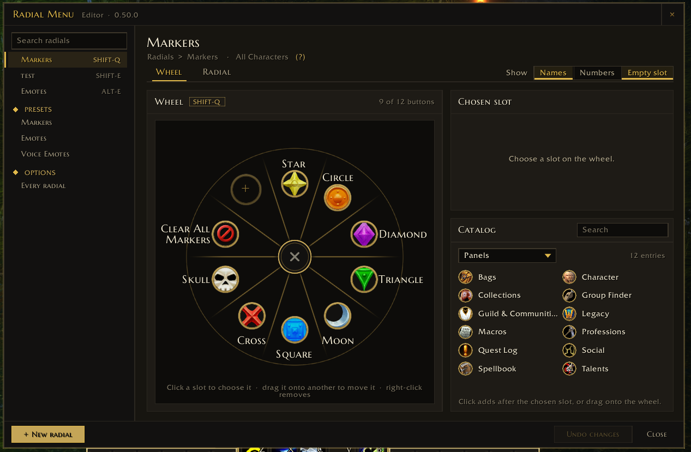
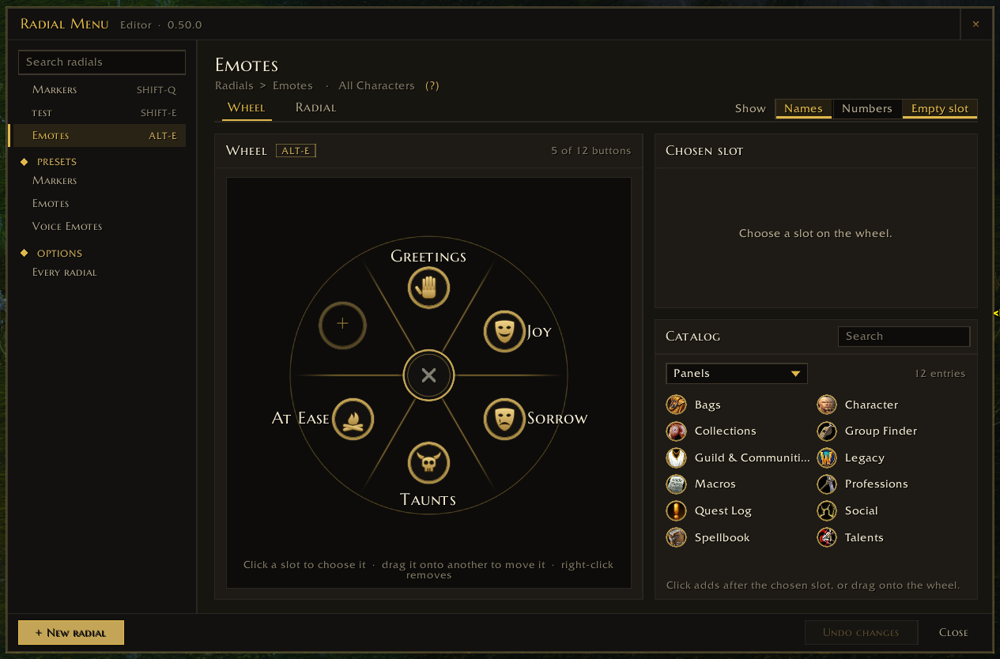
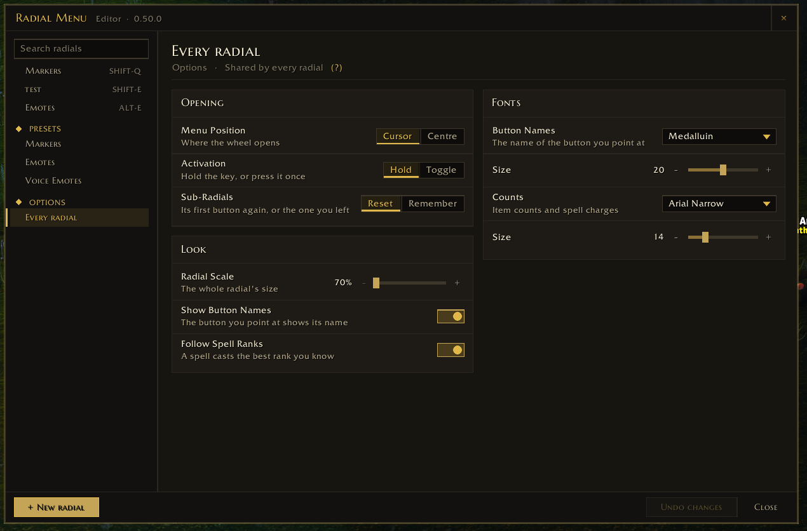

# mdlui_RadialMenu

> **Radial menus for [MedalUI](https://github.com/ahrymx/ahrymx.MedalUI/blob/main/README.md), for WoW Forever (`16001`).**
>
> Based on the radial menu of [FlareUI](https://github.com/malkkav/FlareUI) by **Malkkav**, distributed under the [MIT License](https://github.com/ahrymx/ahrymx.MedalUI/blob/main/WoW/Interface/AddOns/mdlui_RadialMenu/LICENSE).

Hold a key, sweep the mouse towards a button, and let go: the button you aimed at is used, in combat too. A radial holds up to twelve buttons, built in an editor window in MedalUI's look.

---

## The wheel

- **Hold, sweep, release.** The wheel opens at the cursor or the centre of the screen. Let go of the key over a button to use it, or in the centre to cancel.
- **What a button can be:** a spell (at the best rank you know), an item, a mount, a macro, a target or world marker, a game panel, an emote, a quest item, a spell cast on a party member, or another radial.
- **Sub-radials.** A button can open another radial. Hover it and use the mouse wheel to flip through its buttons.
- **Categories.** A button can hold a ring of its own buttons. Click it, or turn the mouse wheel on it, and the ring opens in place while you hold the key; let go over a button to use it, or right-click to go back.
- **Party spells.** A party button holds one slot for you and one for each party member: aim at a person to cast on them.
- **Click mode.** A macro line such as `/click MdlRadial markers` opens a radial that stays up until you click a button.
- **The look.** FlareUI's layout in MedalUI's gold and ink: its own rims (brighter, with a glow, on the button you aim at), an ink backdrop with a thin gold ring, a gold centre ring, pointer and cancel X.

## The editor

`/mdlradial` opens the editor, as does its key binding (Key Bindings > AddOns). The window is laid out like MedalUI's Settings window. On first run, a copy of the **Markers** preset is made for you.

| | |
|:---:|:---:|
|  |  |

- **The sidebar** has a search, then a switch between **My radials** and **Presets**, each with its count.
  - Six category tiles sit under the switch: **Combat**, **Healing**, **Social**, **Group**, **Items** and **Travel & UI**, each with its glyph and count. They start empty: drag a radial onto a tile, or right-click a radial and pick **Move to …**. Click a tile to list only its radials, with the ones in no category under **Not filed**; click it again to list them all. Right-click a tile to **Empty** it.
  - With no tile chosen, each category with radials in it is a heading that folds, then your own groups and the rest. Right-click a radial to group it, and drag to reorder. A category can't be renamed or moved.
  - A radial's key sits in a small box at the right of its row; mouse buttons are short (**ALT-M3**), so names keep their room.
  - Radials this character doesn't get sit under **Not on This Character**.
  - **Presets** lists the ready-made radials under the same category names, and a tile narrows them too: **Markers**, **Emotes**, **Voice Emotes** and **Camping** (a slice for each camp kit you carry, and Sit) and **Consumables** (the best health potion or stone, mana potion or gem, food and drink in your bags; turn the wheel on one for the rest), read-only. Class presets show only for their class: a shaman also gets **Totem Bars** (a ring for each Call: the Call, and the four totems on its page of the totem bar, read live), and a hunter gets **Pet Utility** (rings for Call Pet, Mend Pet with Feed, which feeds your pet the best food it eats, Tame Beast, and the pet's commands and stances). **Add to my radials** makes a copy you can change however you like.
  - **Every radial** sits at the sidebar's foot.
- **The Wheel sheet** holds the radial's wheel, the chosen slot, and the **Catalog**.
  - Click a slot to choose it, drag it onto another to move it, and right-click to remove it.
  - The chosen slot's card sets its place on the wheel. For a spell with ranks, it also sets whether the button casts the **Best known** rank or stays on **This rank**.
  - The Catalog has Panels, Spells, Party, Items, Professions, Macros, Markers, Emotes, Mounts and Radials. Click an entry to add it after the chosen slot, or drag it onto the wheel. You can also drop spells, items, mounts and macros from the game's own windows.
  - A category's card has **Open** (or click its slot twice), which shows its own buttons on the wheel to change them; **< Back** returns. It also has **Rename...** and a row of glyphs to choose its picture. **Category** in the Catalog's Radials makes an empty one.
  - **Show** at the sheets' right turns slot names, numbers and the next empty slot on or off.
- **The Radial sheet** holds who gets the radial and its key.
  - **Who gets it:** every character, a faction, a class, or one character.
  - **Its key:** click it, then press the key; right-click clears it. A character can keep a key of its own.
  - **Macro** puts a macro that opens the radial on your cursor, to drop on a bar. **Copy**, **Rename** and **Delete** sit beside it.
  - **Reset...** puts a preset's copy back as the preset has it. Its name, key and who gets it stay.
  - **On This Character** lists every key that opens a radial here.
- **The footer** holds **+ New radial**, and **Import...** while FlareUI's radials are loaded.
  - A **Changed since it opened** chip shows once you change something. **Undo changes** puts back everything since the window opened: buttons, names, who gets them, and keys.

## Every radial

**Options > Every radial** (`/mdlradial options`) holds what is shared by every radial:

- **Opening:** where the wheel opens (Cursor or Centre); whether you hold the key or press it once (Hold or Toggle); and whether a sub-radial opens on its first button again or on the one you left (Reset or Remember).
- **Look:** the whole radial's size (70%–150%); whether the button you point at shows its name; and whether a spell casts the best rank you know.
- **Fonts:** the font and size of the button names, and of item counts and spell charges. MedalUI's font is the default when MedalUI is installed.

## Importing from FlareUI

With FlareUI enabled, **Import...** in the editor's footer copies its radials, its groups and each character's keys. They are added after the radials you already have. FlareUI's settings are only read, never changed.

## Controller

A radial imported from FlareUI with a stick press keeps it. It opens on a stick press (L3 or R3, with the triggers held or not); the right stick aims, letting go of the stick uses the button, and B closes it. The editor has no controller controls until universal controller support (2.0). With a controller addon such as ConsolePort loaded, no controller button is bound here.

---

## What changed from upstream

- **Stands alone:** no FlareUI and no Ace libraries. LibSharedMedia is used only when another addon has loaded it.
- **MedalUI:** listed under **MedalUI** in the AddOn List. It uses MedalUI's font when MedalUI is installed, and opens from MedalUI's **Radial menu (ext)** settings page (`/mdlui`).
- **Its own names:** `/click MdlRadial <radial>` instead of `/click FUIRadial <radial>`.
- **The editor** is a window of its own, laid out like MedalUI's Settings window, instead of FlareUI's options panel. Its controller rows (stick press, gamepad bar slot) and the controller options are left out until 2.0.
- **The wheel** keeps FlareUI's layout, in MedalUI's gold and ink.
- **Removed:** FlareUI's own micro-menu entries (its settings and its threat meter).
- **Alongside FlareUI:** if FlareUI's radial menu is on too, a chat line says so once, because keys both addons bind go to whichever binds last.

## Commands and settings

| Command | What it does |
|:---|:---|
| `/mdlradial` | Opens the editor |
| `/mdlradial options` | Opens the editor at **Options > Every radial** |
| `/mdlradial list` | Prints your radials with their keys and macro lines |
| `/mdlradial key <number or name> <key>` | Binds a radial, for example `/mdlradial key 1 SHIFT-Q`; `none` clears it |
| `/mdlradial padlog` | Turns the controller aim log on or off |

The editor also opens from its key binding (Key Bindings > AddOns > **mdlui_RadialMenu**) and from MedalUI's **Radial menu (ext)** page (`/mdlui`).

## Install

1. Download the `mdlui_RadialMenu` release zip and extract `mdlui_RadialMenu` into your World of Warcraft `Interface\AddOns` folder.
2. In the character select **AddOns** list, find **mdlui_RadialMenu** under the **MedalUI** category and make sure it is enabled.

## Compatibility

- **WoW Forever 1.60.1** (`## Interface: 16001`)
- English clients.

## Known limitations

- WoW Forever only: there is no Retail version.
- Keys can't be bound or changed in combat.
- The editor has no controller controls until universal controller support (2.0).
- With FlareUI's radial menu on too, keys both addons bind go to whichever binds last.

## Bug reports

- `/mdlradial padlog` prints the controller's aim as you move the stick, for controller reports.
- `/mdlradial list` prints every radial with its key and macro line, to show what is bound where.

---

## Credits and license

`mdlui_RadialMenu` is licensed under the **[MIT License](https://github.com/ahrymx/ahrymx.MedalUI/blob/main/WoW/Interface/AddOns/mdlui_RadialMenu/LICENSE)**.

- **Original addon:** the radial menu of [FlareUI](https://github.com/malkkav/FlareUI) — Copyright © 2026 **Malkkav**
- **MedalUI companion adaptation:** **AhryMX** ([MedalUI](https://github.com/ahrymx/ahrymx.MedalUI))
